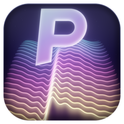

<div align="center">



# 🎹 Massive PSXL

### A wavetable synthesizer by **Phil S Audio** 🎛️

`VST3` · `Audio Unit` · `Standalone` · 🍎 **macOS Apple Silicon (M1/M2/M3)**

</div>

---

> ⚠️ **Status: code-complete, first build pending.** This source was written on a Windows PC that can't produce macOS
> binaries, so it has **not been compiled or run yet** 🧪. Expect a short round of compile fixes on the very first
> build. The GitHub Actions workflow in this repo is the fastest way to find and fix them. See [🔨 Building](#-building).

## ✨ Features

| | Area | What you get |
|---|---|---|
| 🔊 | **Engine** | 16 voices (poly / mono / legato), glide, microtuning |
| 🌊 | **Oscillators** | 2 wavetable oscillators · 10 built-in tables · drag-and-drop audio import · unison ×8 · detune · phase mod · wavefold |
| 🌫️ | **Noise** | White / pink / brown / crackle with colour control |
| 🧪 | **Filters** | 2 filters × 4 models: **Ladder**, **State Variable**, **Comb**, **Formant** |
| 💥 | **Insert + FX** | 6 insert distortions · EQ · distortion · chorus · tempo-synced stereo delay · reverb |
| 🎚️ | **Modulation** | Amp envelope + 8 envelope/LFO slots · 3 × 16-step performers · 16 macros · velocity, key track, random, mod wheel, aftertouch, pitch bend |
| 📈 | **Live visuals** | Moving playheads on every envelope and LFO · glowing signal wires |
| 🔌 | **Routing** | Drag-wire node editor. **Load Init (Blank)** starts with *no* connections |
| 🪄 | **Smart macros** | Drag a macro onto a knob and it **renames itself** to that knob. The host-visible name updates instantly 📟 |
| 🎹 | **Keyboard** | Pull-down on-screen keyboard with pitch + mod wheels · keys light up for incoming MIDI |
| 🌗 | **Themes** | Light and dark mode · resize 75 – 200 % |
| ↩️ | **Workflow** | Undo/redo · MIDI learn · preset browser · performer pattern templates |
| 🎼 | **Presets** | **117 original factory presets** across 8 categories |

## 🎼 Factory presets

| 🎸 Bass | 🎤 Leads | 🌌 Pads | 🪕 Plucks | 🎹 Keys | 🥁 Drums | 🛸 FX | 🔁 Sequence |
|:--:|:--:|:--:|:--:|:--:|:--:|:--:|:--:|
| 20 | 19 | 20 | 15 | 10 | 15 | 10 | 8 |

Your own presets live in `~/Music/Phil S Audio/Massive PSXL/Presets` 📁

## 🔨 Building

### Option A · ☁️ Let GitHub build it (no Mac needed)
1. Push to GitHub (already done if you're reading this there 😄).
2. Open the **Actions** tab → **Build Massive PSXL (macOS arm64)** → **Run workflow**.
3. After ~10–15 minutes, download the **`Massive-PSXL-macOS-arm64`** artifact. It contains the `.pkg` installer 📦.
4. If the build fails, open the failed step and copy the error lines. The first run may well fail, which is expected ✅.

### Option B · 💻 Build on your MacBook
```bash
xcode-select --install            # command-line tools (skip if installed)
brew install cmake                # needs Homebrew

git clone https://github.com/philscottcanada/massive-psxl.git
cd massive-psxl

cmake -S . -B build -DCMAKE_BUILD_TYPE=Release
cmake --build build --config Release --parallel     # first build: ~5-15 min (compiles JUCE too) ☕
```

Then check the sound engine 🧪 and install it:
```bash
build/PSXLTest_artefacts/Release/psxl_test ./test_audio    # offline test, writes a few .wav files
bash installer/install_local.sh build                       # installs for your user, no password
```
Restart your DAW and rescan plug-ins 🔄.

> 🛡️ **macOS blocking it?** Builds are ad-hoc signed. If macOS refuses a *downloaded* installer or plug-in, right-click →
> **Open**, or run `xattr -dr com.apple.quarantine <path>`. Anything you build yourself runs without this.

## 📍 Where things install

| 🧩 Format | 📂 Location |
|---|---|
| **VST3** | `/Library/Audio/Plug-Ins/VST3/Phil S Audio/Massive PSXL.vst3` ← appears under **Phil S Audio** 🎉 |
| **Audio Unit** | `/Library/Audio/Plug-Ins/Components/Massive PSXL.component` *(macOS doesn't allow AU sub-folders; hosts group it by the manufacturer name "Phil S Audio")* |
| **Standalone** | `/Applications/Phil S Audio/Massive PSXL.app` |

## 🚀 Quick start

1. Open the standalone app (or load the plug-in in your DAW).
2. Menu → **Load Init (Blank)** → the synth is silent on purpose 🤫
3. Open the **Routing** tab and drag a wire from **Osc 1** → **Filter 1** → **Out** 🔌
4. Play the keyboard 🎹 (click **Keys** to pull it down) or send MIDI.
5. Drag a **macro** chip from the bottom strip onto **Filter 1 Cutoff** and watch the macro rename itself 🪄

## 🗂️ Project layout

```
📁 Source/       plug-in code   (dsp/ = engine, ui/ = editor)
📁 Resources/    art/ (icon, backgrounds, NKS artwork) · presets/factory_presets.xml
📁 tools/        gen_presets.py · gen_art.py · docs generators
📁 installer/    macOS .pkg builder + local install script
📁 nks/          NKS notes + controller page map
📁 tests/        offline engine test
📁 docs/         manual + video scripts (PDF)
📁 .github/      macOS CI build
```

## 📚 Documentation 📖
- 📘 **User manual + tutorials** → `docs/Massive_PSXL_Manual.pdf`
- 🎬 **Video scripts** (for NotebookLM / Gemini) → `docs/video_scripts/`

## 🎛️ NKS (Native Kontrol Standard)

| ✅ Ready | ⏳ Needs Native Instruments |
|---|---|
| Parameter pages (macros first) · live macro names · artwork · categories | Official NKS badge · `.nksf` preset files · Komplete Kontrol browser listing (free NKS Developer Kit, by application) |

Details in [`nks/README.md`](nks/README.md).

## 🧾 Good to know

- 🔏 **Signing:** local builds are ad-hoc signed. To share with others you need an Apple Developer ID (+ notarisation). The installer script supports `DEVELOPER_ID_APP`, `DEVELOPER_ID_INSTALLER`, `NOTARY_PROFILE`.
- ⚖️ **JUCE licence:** JUCE is AGPLv3 or commercial. Distributing closed-source needs a JUCE commercial licence. Keep this repo **private** unless you're open-sourcing it.
- 🎨 **Originality:** presets, wavetables, artwork and UI are all original. No third-party preset content was copied or converted.
- 👂 **Not tuned by ear yet:** sounds were designed from parameter knowledge, so expect to tweak them.

---

<div align="center">

Made with 💜 by **Phil S Audio** 🎶

</div>
